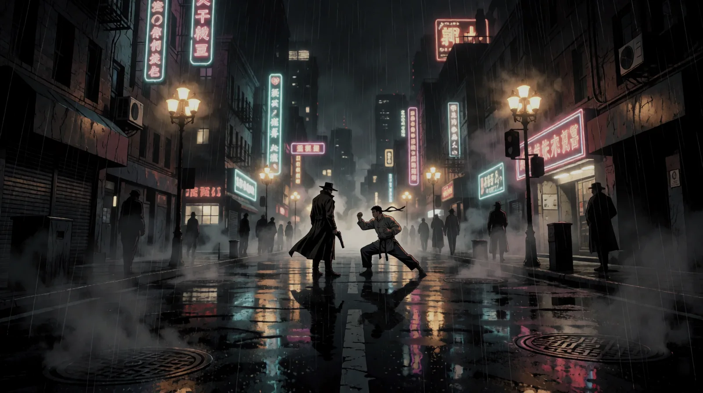

<p align="center">
  
</p>

<h1 align="center">KINETIK</h1>
<p align="center"><b>Cinematic Action Roleplaying</b><br>Gun-Fu · Martial Arts · Anime</p>

<p align="center">
  <a href="https://kinetik.redneck-design.de/?lang=en"><b>Open the web app</b></a> ·
  <a href="export/KINETIK_Rulebook_v3.6.pdf"><b>Rulebook (PDF)</b></a> ·
  <a href="regelwerk/KINETIK_Regelwerk.en.md">Rules text</a> ·
  <a href="README.md">Deutsch</a>
</p>

A pen-and-paper rulebook for boundless, cinematic action. Fast, deadly fights built on a **2d6 Clash system** where attacker and defender roll against each other, and a **Title system** in which experience beats raw talent. Plus a web app to play at the table or online: character sheet, map, music, dice and a dashboard for the Game Master. Runs in the browser, no account, no server.

## The game in one minute

**Every check: 2d6 + attribute + Mastery.** Mastery comes from Titles such as *Ex-Hitman* or *BJJ Student*, but only if the Title covers the action.

**In combat both sides roll.** The difference Δ decides:

| Δ (attacker − defender) | Result |
|---|---|
| 3 or more | **Dominance**: a perfect hit, Momentum |
| 0 to 2 | **Exchange**: both sides land hits |
| −1 to −2 | **Counter**: the defender strikes back |
| −3 or less | **Perfect Counter** |

There are no hit points: hits cost **Protection**, then **Willpower**, and only hard hits cause **injuries** on the body silhouette. **Moves** are techniques you build yourself from a fixed grid of effect points.

Everything else is in the [rulebook](regelwerk/KINETIK_Regelwerk.en.md) (currently **v3.6**, alpha, in active development). The German text is the reference; the English translation is kept line for line in step with it ([glossary](regelwerk/GLOSSARY.en.md)).

## The web app

**[kinetik.redneck-design.de](https://kinetik.redneck-design.de/?lang=en)** (mirror: [rec0il.github.io/KINETIK-PNP](https://rec0il.github.io/KINETIK-PNP/?lang=en)): in the browser, usable offline, on phone and desktop. The interface is available in English and German; it follows your browser language and can be switched in the header.

- **Character sheet** with Titles and bonus matrix, body silhouette, dying counter, Protection shield, tags, weapons, notes and JSON import/export. A guided creation wizard, or a blank sheet.
- **Multiplayer without a server**: the GM's tab is the host, players join with a room code and the GM confirms. Reconnecting works by itself.
- **Dice**: checks against a Difficulty (DC), a Clash calculator with Hero Threshold and Out of Reach, secret GM rolls, 3D dice, a log.
- **Map**: grid, tokens, fog, ping, measuring; several scenes, one of them live for the players.
- **Music** from the GM, synchronized for everyone, with crossfades (nine bundled tracks).
- **Combat tools**: side initiative, Pressure, enemies with Protection, Willpower and injuries, handouts; combat on the map with player plans, Bullet Time and one-click resolution, poison ticking at round end.
- **Move builder** by chapter 5: EP, cost and minimum level live, usable without a character.
- **Ten looks** (Neo-Noir, Film Noir, Manga, Wushu, Ukiyo-e, Western, Dossier, 8-Bit, Terminal, Cyberdeck) with their own shapes, fonts, effects and images.
- **PenNodePaper bridge** for the GM, see the [German README](README.md#pennodepaper-brücke-sl).

A character created in German works in an English session and the other way round: tags and legendary-move prices are recognised in both languages. Broadcast messages from the GM (toasts, roll labels) arrive in the GM's language.

### Getting started

**Play:** open the page, choose "Player", create a character (or load the example, Jin) and fill it in. To join a session: "Join", enter the room code and your name.
**Run a game:** "Game Master", "Start a session", send the room code or link to the players and keep the tab open.
Behind strict office or campus Wi-Fi you can set your own signaling or TURN server under "Advanced". Details: [`tools/kinetik-vtt`](tools/kinetik-vtt/README.md).

## The illustrated PDF

The rulebook comes as a typeset book with a cover, chapter banners and an image per section, in all ten looks: [`export/KINETIK_Rulebook_v3.6.pdf`](export/KINETIK_Rulebook_v3.6.pdf) (default look) and the other looks as downloads in the web app. The English edition reuses the pictures of the German edition; only the gap-filling images that depend on text length are made again. Built with [`tools/rulebook-pdf`](tools/rulebook-pdf/README.md).

## Repository

```
regelwerk/   Rules text (German reference, English translation, glossary)
data/        Machine-readable rules data (data/i18n/en: English texts)
tools/       kinetik-vtt (web app), rulebook-pdf (PDF export with AI images)
assets/      Graphics and PDF projects (pdf, pdf-en, pdf-themes, pdf-themes-en)
export/      Finished PDFs
scripts/     Helper scripts (data check, translation check, web rulebook, images)
```

Develop: `cd tools/kinetik-vtt && npm install && npm run dev`, tests with `npm test`. See the [German README](README.md#entwickeln) for the full workflow.

## Credits and legal

- **Rules and idea**: Alexander Freidzon (Rec0iL), © 2026
- **Images**: generated with Krea 2 in ComfyUI. **Music**: Kevin MacLeod ([incompetech.com](https://incompetech.com)), [CC BY 4.0](https://creativecommons.org/licenses/by/4.0/). **Fonts**: Google Fonts (SIL OFL 1.1).
- **License**: rules text, translations, rules data and images [CC BY-NC-SA 4.0](https://creativecommons.org/licenses/by-nc-sa/4.0/deed.en) (non-commercial, share-alike); source code [MIT](LICENSE). Details in [`LICENSE-CONTENT.md`](LICENSE-CONTENT.md) (German).
- **Imprint and privacy policy** are German legal texts: [web app](https://kinetik.redneck-design.de/#/impressum). The operator details are not in the repository.
