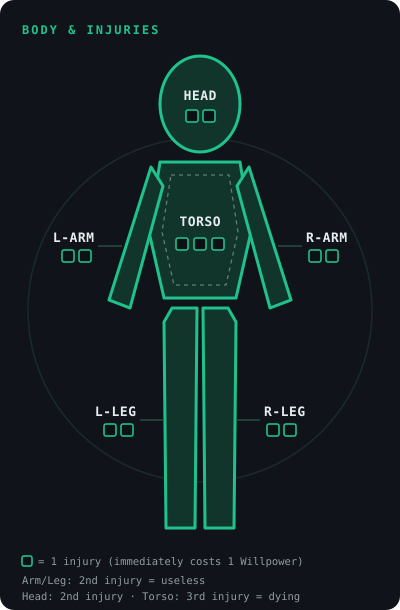

# **KINETIK: Cinematic Action Roleplaying**

*A tabletop rulebook for boundless, cinematic action. Version 3.6.*

---

## **1. Core Philosophy**

This system rewards creativity. It doesn't punish players for cool descriptions with extra penalties; it spurs them on with **Momentum** and **Bullet Time**. Fights are fast, deadly and cinematic. We use a dynamic "Clash" system in which attacker and defender cross blades (or bullets).

**Experience counts.** Talent opens the door, but Titles (training, experience, Mastery) decide who's still standing at the end. A giant with no experience won't wrestle a grandmaster to the ground.

**Detail to taste.** The rules work just as well with a handful of broad moves as with a full arsenal of Taekwondo, Karate and Muay Thai techniques. As long as every move follows the framework from Chapter 5, the table decides how deep it wants to go.

**Power scale by setting.** The Game Master (GM) decides how powerful the world is. In a John Wick setting, John Wick is the pinnacle and therefore level 10; in the Naruto universe the same goes for late-series Naruto; and in a Jackie Chan setting, Jackie is one of the most skilled fighters of his style. Title level always measures rank **within the setting**, never absolute strength. Street fights, Gun-Fu or Ki battles: the same 2d6 and the same move framework carry it all. The table decides how high the world's ceiling goes.

---

## **2. The Character**

### **2.1 The Attributes (2d6 System)**

For a check, roll **2d6 + attribute + Mastery**. Mastery only counts if a Title covers the action (see 2.2). Attributes range from **-1 to +3** (cap +4 through a Title at level 10).

* **Flow:** Acrobatics, soft martial arts, evasion, seamless movement.
* **Precision:** Marksmanship, aimed hits on weak points, fine work.
* **Force:** Brute destruction, physical strength, unstoppable attacks.
* **Instinct:** Reflexes, sensing danger, acting on gut feeling.
* **Focus:** Tactics, analytical thinking, deduction, logical reasoning.

Attributes grow with Titles (see 2.2, attribute growth).

### **2.2 The Title System (Level 1 to 10)**

Every character has Titles (e.g. *Ex-Hitman*, *SWAT-Operator*). A Title consists of:

* **Level (1-10):** The degree of experience.
* **Domain:** 3 to 5 key areas where the Title applies (e.g. *Ex-Hitman*: firearms, infiltration, intimidation).
* **2 lead attributes:** The attributes the Title typically uses (e.g. *BJJ Student*: Flow and Force).

**Only the Title that covers an ability grants a bonus for it.** An ex-killer is no judoka: for a Judo Throw, the *BJJ Student* Title counts, not the *Ex-Triad Contract Killer*, even if that one is higher. Actions no Title covers run at level 0, i.e. on the attribute alone.

**Mastery (M) = level ÷ 2, rounded down.** It's added to the roll as a bonus when the action fits the Domain, and it lowers the Energy cost of moves from that Domain (see 5.1).

| Level | 1 | 2 | 3 | 4 | 5 | 6 | 7 | 8 | 9 | 10 |
|---|---|---|---|---|---|---|---|---|---|---|
| Mastery | 0 | 1 | 1 | 2 | 2 | 3 | 3 | 4 | 4 | 5 |

**How it applies:**

* **Roll within the Domain:** 2d6 + attribute + Mastery.
* **Non-lead attribute:** If an action uses an attribute other than the Title's two lead attributes, only half the Mastery counts (rounded down). At levels 1 to 3 that's 0, so at those levels Titles only work through their lead attributes.
* **Several fitting Titles:** The highest one counts; Mastery values are not added together.

**Attribute growth:** When a Title reaches level **4, 7, 9 and 10**, one **lead attribute** of that Title rises by +1 each time (player's choice). The cap is +3. If both lead attributes are already at +3, the point may go to any other attribute. At level 10, a lead attribute may break the cap and rise to +4.

**Sample curve** (one Title, lead attribute starts at +2):

| Title level | Attribute | Mastery | Bonus in the Domain |
|---|---|---|---|
| 1 | +2 | 0 | +2 |
| 3 | +2 | 1 | +3 |
| 4-5 | +3 | 2 | +5 |
| 6-7 | +3 | 3 | +6 |
| 8-9 | +3 | 4 | +7 |
| 10 | +4 | 5 | +9 |

**Level milestones:**

| Level | Unlocks |
|---|---|
| 4, 7, 9, 10 | Attribute growth (through the attributes, this also raises Energy and Willpower) |
| 5 | Momentum cap +1 |
| 8-9 | Master Moves (up to 7 EP) |
| 10 | Legendary Moves, Momentum cap +1, minimum cost for moves no longer applies |

**Level pacing:** The GM awards level-ups through *Learning by Doing*, *cinematic roleplay* or *training montages* during downtime. Guidelines: levels 2 and 3 come fast (about one session per level), levels 4 to 6 each take a story arc, and levels 7 to 10 are awarded only at milestones.

### **2.3 Resources & Injuries**

1. **Body & injuries:** There are no classic hit points. A hard hit results in a narrative injury on the body silhouette (e.g. *Shot Through the Shoulder*, *Shattered Knee*) that rules out certain actions. The silhouette has six zones: head, torso, left arm, right arm, left leg, right leg.
   * **Arms and legs:** The second injury makes the limb useless.
   * **Head:** The second injury leaves the character dying.
   * **Torso:** It's tougher and holds 3 injuries; the third leaves the character dying.
   * **Shock:** Every injury immediately costs 1 Willpower.
   * **Zone choice:** For a normal injury, the GM picks the zone to match the attacker's description. The player picks it only with a move ("Choose Zone") or through Bullet Time (see 3.9).
   * *Special maneuver "Bone Wrap" (2 Willpower):* The pain is pushed aside for a moment; the body part works at full strength for one action.

    

2. **Protection (Armor & Luck):** A value from 0 to 3. Protection is **context-dependent** (it only works against matching attack types, e.g. a ballistic suit counts against bullets, not against a brutal kick). It works as a **threshold**:
   * **Protection adds to the injury threshold.** An injury needs a difference of at least **Dominance threshold + Protection** (see 3.2). So Protection 2 means: injury from a difference of 5 instead of 3.
   * **Attrition:** Every hit that doesn't punch through Protection chips it down by 1 (until the end of the scene). At 0 Protection, the damage goes to Willpower (see Cascade in 3.2).
   * **Restoring:** At the end of the scene (short rest), Protection is back to full; in combat, only through moves.
   * **Penetration:** Moves can lower, ignore or destroy Protection for this Clash.
   * **Weapons and Cover** lower or add to Protection, see 2.5.
3. **Willpower (WP):** Combat morale. Maximum: **6 + Instinct + Focus** (rises with the attributes). Drops through shock (injuries), extreme pain, demoralization and intimidation. At 0 you're **Broken** (see 3.10).
4. **Energy (Chi / Stamina):** The fuel. Maximum: **6 + Flow + Force** (rises with the attributes). Expensive moves cost Energy. It also drops through breathlessness, paralysis and exhaustion (e.g. chokeholds, nerve strikes). At 0 you're **Winded** (see 3.10).
5. **Momentum:** See 3.8.

Energy and Willpower never rise above their maximum.

### **2.4 Character Creation**

| Campaign tier | Attribute budget | Title-level budget | Max. starting level per Title |
|---|---|---|---|
| Street | 3 | 3 | 2 |
| **Cinema (Standard)** | **4** | **4** | **3** |
| Legend | 5 | 7 | 5 |
| Custom | free | free | free |

* **Custom tier:** The table sets the attribute budget, title-level budget and maximum starting level per Title itself. The campaign tier only governs creation; after that, the character grows through their Title levels.
* **Attributes:** All start at 0. The starting maximum is +2; a **Prodigy** may have +3 in one attribute. An attribute at -1 refunds 1 point (for at most two attributes). Count the values above 0, minus these refunds.
* **Titles:** Spread the level points across your Titles. For each Title, set its Domain (3 to 5 areas) and 2 lead attributes.
* **Titles at level 4 or higher:** If a Title starts at level 4 or higher at creation (only possible in the *Legend* tier), it brings its attribute growth along right away. This +1 comes on top of the attribute budget and may raise the starting maximum from +2 to +3.
* **Resources:** Energy = 6 + Flow + Force, Willpower = 6 + Instinct + Focus.
* **Starting bonus:** A Cinema character usually has **+3** in their Domain (attribute +2, Mastery 1).

*Example (Cinema, attribute budget 4, title-level budget 4):* Mara is a **Prodigy** with a gun. She sets **Precision to +3** and **Instinct to +2**. That's 5 points, but she sets **Force to -1** and gets 1 point back, so she stays within the budget of 4. Flow and Focus stay at 0. Her Title is *Sniper (Level 3)* with the Domain firearms, camouflage, observation and the lead attributes Precision and Instinct, plus *Hunter (Level 1)* for the remaining points. Her bonus when shooting: Precision +3, Mastery 1, so **+4**. A character who isn't a Prodigy only reaches +3 at the start. The trade-off: Mara has Energy 5 (6 + Flow 0 + Force -1) and is an easy target in melee (Force -1).

### **2.5 Weapons & Cover**

**The weapon sets the profile, the Title sets the skill.** A master sniper who hits at 2 km hits just as well with a pistol: a Title with the Domain "firearms" covers every firearm. There are **no range penalties**. Firearms work in melee too (Gun-Fu): barrels get shoved aside, magazines yanked out, shots crack past your ears left and right. A melee duel between a sniper with a .50 and an akimbo pistolero is explicitly encouraged.

**Weapons are deadly.** Every real weapon has two things:

1. **Penetration 1** on every attack: the target's Protection drops by 1 for this Clash.
2. **A profile:** a free effect from the EP catalog (5.1). Light weapons have 1 EP, heavy ones 2 EP. The profile applies for free on every attack with this weapon, just like the main part of a move on an Exchange or better (3.2).

| Weapon | Class | Profile |
|---|---|---|
| Pistol | light (1 EP) | Choose Zone |
| Knife | light (1 EP) | +2 Energy damage (pain, blood loss) |
| Baton / tonfa | light (1 EP) | minor tag *Dazed* |
| Akimbo pistols | heavy (2 EP) | second target, Choose Zone |
| Assault rifle | heavy (2 EP) | second target, +1 Protection damage |
| Shotgun | heavy (2 EP) | second target, minor tag *Prone* |
| Sniper rifle (.50) | heavy (2 EP) | **Penetration 2** instead of 1, minor tag *Dazed* (shockwave) |
| Katana | heavy (2 EP) | Choose Zone, +1 Protection damage |
| Fragmentation grenade | heavy (2 EP), thrown, single use | up to 3 targets (3.14) |
| Flashbang | Explosive (3 EP), thrown, single use | up to 3 targets, minor tag *Blinded* |
| LMG (sustained fire) | heavy (2 EP) | second target, minor tag *Pinned Down* |
| Rocket launcher | Explosive (3 EP), single shot | Area (3.14) |

* **Combining with moves:** The weapon's profile and Penetration apply on top of a move. Duplicate effects count only once, and Penetration drops away if the move already ignores or destroys Protection.
* **Custom weapons:** The GM builds more profiles on the same pattern.

**Deadly Hands:** An unarmed martial-arts Title at **level 4** or higher turns hands and feet into weapons: they gain **Penetration 1** (but no profile). That keeps martial artists competitive against armed opponents.

**Cover:** Cover is a protection type against gunfire: **wooden table 1, car door 2, concrete pillar 3**. It wears down like Protection (wood splinters, glass shatters), doesn't work in melee and ends the moment you leave it. Cover and armor don't add up; the higher value counts. Moves like Ricochet ignore Cover.

**Wear and Complications:** The GM decides how long weapons hold up. Complications typically come in as a minor tag via the Exchange drawback: *Jam*, *Magazine Empty*, *Blade Stuck in Bone*, *Barrel Pushed Aside*, *Fouled* (Penetration drops away until the weapon is cleaned). Major complications (the weapon breaks, the blade dulls and loses its profile) come as the Price of a Legendary Move, as a "Success at a Cost", or creep in over the course of a story. Small weapon tags can be flipped with the Kinetic Rule: the yanked-out magazine is caught in midair and slammed straight back into the magwell.

**Reloading.** The same goes for all firearms: swapping a magazine, filling a cylinder or stuffing in shells takes just as long, whether it's a pistol, an M4 or a shotgun. Reload **in a Clash** and you take the minor tag *Reloading* (opponent +1 in the next Clash). In quiet moments (cover with no attacker, a lull) it's free. **Heavy weapons** (belt-fed LMG, rocket launcher, flamethrower) take a **full action** and also bring the tag. Like any minor tag, it can be flipped with the Kinetic Rule (3.3), and a move like *Wick Flick* (5.2) makes it unnecessary altogether.

**Ammo tracking (optional):** If you like more precision, track ammo with a **d6** at the table (online too).

* **Magazine:** A weapon holds **6 attacks**, heavy weapons **3**, a rocket launcher **1**. Every attack with the weapon (including defensive shots) counts the d6 down by 1. At 0 the magazine is empty, and the next attack requires reloading first (see above).
* **Supply (one more layer, depending on the setting):** Every character carries **3 magazines per weapon** (heavy weapons 2). Resupply comes through the story, looting or a rest. Without supply, the table plays with the magazine alone.
* **Moves and Momentum:** Some moves reload as part of their effect (*Wick Flick*, *Drum Flip*, 5.2). That removes the tag, and with Momentum moves, reloading can even become a showpiece.
* **Without tracking**, the complications above (*Jam*, *Magazine Empty*) stay in the GM's hands.

**Brutality (optional):** For especially lethal tables: a weapon hit against a target **without matching Protection** already causes an injury at Δ = T - 1 (the top Exchange value).

---

## **3. Combat (The Clash System)**

### **3.1 The Dice Mechanic (The Clash)**

In KINETIK, combat is always an opposed roll (PvE or PvP alike). The attacker rolls their attack attribute, the defender their reaction attribute (e.g. Flow to dodge, Force to block). Each side adds the Mastery of the matching Title.

**Both sides roll 2d6 + attribute + Mastery.** What matters is the difference **Δ = attacker - defender**. Each side has its own Dominance threshold: **T(A)** for the attacker and **T(V)** for the defender. By default, both are **3** (exceptions: Hero Threshold, 3.4).

| Δ | Result |
|---|---|
| **T(A) or more** | **Dominance:** The attack lands perfectly. |
| **0 to T(A) - 1** | **Exchange:** A dirty fight, and both sides land hits. |
| **-1 to -(T(V) - 1)** | **Counter:** The defender fends off the attack and strikes back. |
| **-T(V) or less** | **Perfect Counter:** The defender owns the situation. |

*Example:* With T(A) = 2 and T(V) = 4, Δ = 2 is already Dominance, Exchange covers only 0 to 1, Counter runs from -1 to -3, and only at -4 or below does a Perfect Counter happen.

* **Dominance:** Full effect, see 3.2. The attacker gains **+1 Momentum** and **+1 Energy** (restrictions in 3.10). The defender gets no chance to strike back.
* **Exchange:** The attacker chooses: either they push the attack through and *both* sides take a normal hit, OR they push the attack through, but **the GM gives them a minor tag** as a tactical drawback (e.g. *Weapon Stuck*, *Off Balance*, *Cover Lost*) that the opponent can exploit (see 3.3).
  * A tie (Δ = 0) goes to the attacker and counts as an Exchange.
* **Counter:** The attack whiffs or gets blocked. The defender takes control and lands a normal hit on the attacker. The attacker gains no Momentum.
* **Perfect Counter:** The defender gets the effect of a Dominance (read the difference from their side). They gain **+1 Momentum** and **+1 Willpower**.

### **3.2 The Effect of a Hit (Cascade)**

An attack without a move deals **standard damage** down the Cascade **Protection → Willpower → Injury**:

* **Normal hit** (Exchange, Counter): **-1 Protection** for the target (only if it has matching Protection above 0), otherwise **-1 Willpower**.
* **Dominance** (Δ ≥ T): **injury** if Δ ≥ **T + Protection**. If the difference falls short, the hit is absorbed (-1 Protection and -1 Willpower).
* **Momentum** comes at Δ ≥ T, regardless of Protection. Armor never stalls the action.
* **Penetration and ignore effects** work on **effective Protection** (Protection minus Penetration, or 0 when ignored). If no effective Protection above 0 applies to the hit, a normal hit goes straight to Willpower.

**When do moves take effect?**

* **The bulk of a move takes effect from an Exchange up** (Δ ≥ 0): tags, ignoring or destroying Protection, damage to Energy or WP, extra targets.
* **Injuries and Momentum are reserved for Dominance**, unless the move has the effect "injury even without Dominance".
* **The same goes for the defender:** their moves take effect on a Counter, injuries only on a Perfect Counter.
* **Exception:** Legendary Moves always need Dominance (see 5.4).

### **3.3 Tags**

Tags describe conditions such as *Prone*, *Disarmed*, *Blinded* or *Immobilized*.

* **Minor tag:** The opponent gets **+1** on every Clash in which they can exploit the tag (e.g. against someone who is *Prone*).
* **Major tag:** The opponent gets **+2**, or the affected action is denied outright (*Immobilized*: no movement; *Choked*: no words, no Catch Breath).
* **Stacking:** Tags add up, but to no more than **+3** per Clash.
* **Removing:** A tag ends with a fitting action (standing up, picking up the weapon, wiping your eyes clear) or with the scene.
* **The Kinetic Rule:** Players can flip one of their **own minor tags** with a creative description. The tag disappears, and the opponent gets a fitting minor tag instead. *Example:* Jin has a *Jam*. Instead of reloading, he flicks the hot casing into his opponent's face: the jam is gone, and the opponent is *Blinded*. Major tags cannot be flipped.
* **Home Turf:** A minor tag is only a drawback if the affected character isn't in command of the situation. If one of the **character's Titles covers the situation**, the minor tag gives the opponent no +1. A BJJ fighter on the ground isn't *Prone* in the sense of the drawback, and an aikidoka isn't rattled by a simple grab. This applies only to minor tags. Major tags (*Immobilized*, *Joint Locked*) still apply and can only be broken with a fitting move (see *Lock Reversal*, 5.2).
* **Voluntary:** Anyone who deliberately puts themselves into a position with a fitting description (pulling guard, dropping to the floor) takes the minor tag on as part of their action. That fulfills the prerequisite for moves that need this position. If the position isn't the character's Domain, the tag stays a real risk.

### **3.4 The Hero Threshold**

If a player outclasses their opponent in total bonus (attribute + Mastery) by **2 or more**:

* Their Dominance threshold (T(A) as attacker, T(V) as defender) is **2** instead of 3.
* The NPC's Dominance threshold against them rises to **4**.

The Hero Threshold applies only between player characters and NPCs, never between two player characters. The comparison uses the total bonus from attribute and Mastery. Tags, Outnumbering and other roll modifiers don't count for it.

Against equal or stronger opponents, nothing changes. So players only benefit where it makes cinematic sense. (Probabilities: Appendix A.)

### **3.5 Out of Reach (Class Gap)**

What counts is the **total bonus gap** between the two sides in the Clash at hand (attribute + Mastery):

* **Gap of 5 or more:** The underdog can score neither Dominance nor a Counter. Their best result is an Exchange. The only way around this is **Heroic Resistance** (3 Momentum): the Clash is then rolled normally.
* **Gap of 8 or more:** No more rolling. The stronger side narrates the outcome. The underdog can only flee, surrender or use Heroic Resistance.

*To clarify:* The gap is made up only of attribute and Mastery. Tags and Outnumbering don't count. The underdog is capped at an Exchange: as **attacker**, a Dominance becomes an Exchange; as **defender**, a Counter or Perfect Counter becomes an Exchange.

*For perspective:* At a gap of 5, the underdog only wins 5% of Clashes on the dice anyway. The rule turns "almost never" into a clear "only with heroism". A level-10 grandmaster (+9) keeps an untrained bruiser (+3) safely Out of Reach with a gap of 6.

### **3.6 Round Structure: Side Initiative with the Kinetic Marker**

* **Side by side:** One side acts completely, then the other. Within a side, the order is up to the players.
* **Actions:** Each character has **1 action per round** (attack, move, Catch Breath or Compose). Defending is a reaction and costs no action. Every attack against a character triggers a Clash.
* **The Kinetic Marker:** A physical marker on the table (a coin, a bullet casing). At the start of combat, it sits with the players' side (in an ambush, with the side springing the surprise). **Whoever scores a Dominance or a Perfect Counter pulls the marker to their side.** The side holding the marker starts the next round. The GM doesn't have to count anything, just keep track of the last big hit.
* **Interrupt:** Acting before the opponent is only possible through moves (e.g. Iaijutsu Quickdraw). Slow, heavy fighting styles usually lack such moves, so for them, interrupting is hard to impossible.

### **3.7 Multiple Opponents: Goons, Elites and Bosses**

**Goons (Henchmen):**

* Level 0, bonus +0, *no* Protection.
* **A normal win takes out 1 Goon.** If a player wins with **Dominance**, they ride the flow and take out **2 to 3 Goons** at once.
* A **Goon group acts as one character** (one action, one roll).

**Elites/Bosses:** They have Protection (armor/abilities), their own Energy/Willpower and high attributes. The GM rolls for them with everything they've got.

**Outnumbering:** If several opponents attack the same target, they roll together, once. They get **+1 per additional attacker, maximum +3**.

**Goons as attackers (Pressure):** When a Goon group lands a hit on a player character, a **Pressure counter per player character** ticks up. Any Exchange or better counts as a hit, including an Exchange in which the player is the attacker and chooses "both sides take a hit".

1. **1st hit:** -1 matching Protection, otherwise -1 Willpower. The counter goes to 1.
2. **2nd hit in a row:** The character suffers an **injury**. The counter goes to 0.
3. **Any win by the player** (Dominance, Counter, Perfect Counter) resets the counter to 0.

**NPC ladder (guidance for the GM):**

| Type | Level | Bonus in their Domain | Protection / Willpower (guideline) |
|---|---|---|---|
| Goon | 0 | +0 | 0 / none |
| Thug | 1-2 | +2 | 0 / 4 |
| Elite | 3-5 | +4 to +5 | 1 / 6 |
| Boss | 6-8 | +6 to +7 | 3 / 8 |
| Nemesis | 9-10 | +8 to +9 | 3 / 10 |

Protection and Willpower are guidelines, and the GM adjusts them. The Elite and Boss values come from the simulations in Appendix A.

### **3.8 Momentum**

* **Generation:** +1 for Dominance on the attack or for a Perfect Counter on defense. Also through Bullet Time (see 3.9).
* **Starting Momentum:** Smart preparation before the fight (prep work) or a successful ambush grants 1-2 starting Momentum. The two don't stack; the higher value counts.
* **Cap:** Maximum **3 Momentum**. The cap rises **+1 from level 5** and **+1 from level 10** (highest Title). Hitting the cap is your cue to spend it on moves and then build Momentum back up.
* **Scene decay:** At the end of a fight, all Momentum drops to 0. Use it for big moves!

### **3.9 Bullet Time (Rule of Cool)**

If a player describes their action so cinematically that the whole table is on board, the GM can grant them **Bullet Time**. The player chooses how to use it:

* **Choose Zone:** They decide which zone an injury from this action lands in.
* **+1 EP:** Their action gains an extra 1 EP effect from the catalog (5.1) for free, or one move in this action costs 1 EP less.
* **+1 Momentum.**

Bullet Time is granted at most **once per player per round**. The GM awards it for real highlights, not for every action.

### **3.10 Regeneration, Unconsciousness and Broken**

**Catch Breath (for every character):** A tactical action that every character has from the start. The effect is the same for everyone: **+2 Energy**. The next Clash against the character gets **+1** (they're briefly vulnerable). The player names and describes the technique themselves (e.g. circular breathing, meditation, a cigarette in the shadows).

**Compose:** The same setup for the mind: **+2 Willpower**, and the next Clash against the character gets **+1**.

**Other sources:**

* **Dominance** gives **+1 Energy**, and a **Perfect Counter** gives **+1 Willpower**. This only applies **against opponents of level 1 or higher** (not against Goons) and **at most once per round**.
* **Encouragement** from allies gives **+1 Willpower**.
* **Title moves** can restore Energy or Willpower, including for allies (see 5.1).
* **Rest:** After the fight (short rest), Energy and Willpower refill.
* **Ceiling:** Energy and Willpower never rise above their maximum.

**Winded (Energy 0):** Your own costs never take Energy below 0. What you can't pay for, you can't do. At 0, Energy moves are locked until you recover through Catch Breath or similar.

**Unconsciousness (Energy Overflow):** If an enemy action drains more Energy than you have (e.g. a chokehold, a nerve strike), **you drop below 0 and fall unconscious**. You're out of play until the end of the scene.

**Revive:** An ally can bring an unconscious character back with an **action + check against DC 9**. The revived character then has 1 Energy.

**Broken (Willpower 0):** The fighting spirit is gone, and the character breaks.

* **Last Gasp:** Before they collapse, the character may **once**, immediately (even out of turn), declare one last action: **roll +2**, and one move of up to **cap + 2 EP** is **free** (no Energy, no Momentum). Then comes the Collapse.
* **Or** they forgo it and give up or flee.
* **Collapse:** The character is out of action (frozen, panicking, giving up) until the end of the scene, or until an ally brings them back with an **action + check against DC 9** (they then have 1 Willpower).
* **NPCs** flee, surrender or freeze. **Bosses** get a Last Gasp too.
* **Willpower Overflow:** If an enemy action drives Willpower **below 0**, the character collapses immediately, with no Last Gasp.

### **3.11 Taken Out, Dying and Healing**

| Opponent | Taken Out at |
|---|---|
| **Goon** | 1 hit |
| **Thug** | as Elite |
| **Elite** | WP 0 (flees, surrenders) or 2 injuries |
| **Boss** | 3 injuries total, 2 injuries to the head or 3 to the torso. At WP 0, Broken with a Last Gasp. |
| **Player character** | 2 injuries to the head or 3 to the torso (dying). At WP 0, Broken (3.10). |

* **Dying:** The character dies after **3 rounds** unless someone stabilizes them. Stabilizing takes an **action + check against DC 9** (Focus, or a fitting Domain such as Medicine).
* **Healing:** Each downtime phase heals **1 injury**, or 2 with a successful Medicine check. Useless limbs and severe wounds can remain as a **Scar** (permanent tag).

**Killing.** Killing the helpless isn't combat. It's a choice. A character counts as **helpless** if they're unconscious, tied up with no chance to react, or have surrendered.

* **Coup de Grâce:** An action without a Clash. Helpless NPCs die. A **player character is left dying** instead (3 rounds, see above), not killed outright. So their fellow players always have a window to step in.
* **Overflow on the unconscious:** Anyone knocked out by Energy drain (3.10) has negative Energy. If further drain (strangling, poison, suffocation) takes more, the value keeps going negative. **Every full 3 points below 0 is 1 injury** to the zone of the cause: **head** for strangling and suffocation, **torso** for poison. The normal zone rules (2.3) apply, so the head leaves you dying at 6 points below 0, the torso at 9. **A dying character who keeps losing Energy dies.**
* **Tracking:** You can track the Overflow with one or two d6 on the table (one for the ones, one for the injuries), online too.
* **Revive** (3.10) resets Energy to 1, but the injuries remain.
* **Strangling:** The victim is unconscious and stays *Choked*. The strangler keeps choking as an action without a roll and drains 3 Energy per round. That's **about 3 rounds** from unconsciousness to death. An ally has to break the strangler's hold in that time (Clash against the strangler; on a success, the tag ends).
* **No mandatory move:** Killing needs no move, but the GM may impose consequences (Debt or Reputation, see the Prices in 5.4).

**Poison.** Poison is an effect with a clock on it, and it's bought with EP (5.1).

* **Delivery:** A hit only gets poison into the body if the matching Protection is at **0** (never had any, worn down, or bypassed through Penetration or ignore) or if the hit causes an injury. That's why a blowgun aims for the neck or face, and a vest catches the dart.
* **Tiers:** The victim is *Poisoned* and loses **Energy at the end of each round**:

| Tier | EP | Effect |
|---|---|---|
| **Weak** | 1 | -1 Energy for 2 rounds (-2 total). |
| **Strong** | 2 | -2 Energy for 2 rounds (-4 total). |
| **Paralytic** | 2 | Instead of Energy loss, the major tag *Paralyzed* until the end of the scene or an antidote. |
| **Lethal** | 3 | After the Delay, the victim is **dying** (see above). An antidote has to succeed before then. |

* **Delay:** When building the move, the poisoner decides whether the poison works instantly or only after **up to 3 rounds**. This costs nothing: the assassin wants to be long gone before it kicks in. Count in full rounds: with Delay 2, two round ends pass without effect, then the poison takes effect at the end of every following round (with Delay 0, already at the end of the round of the hit).
* **Antidote:** An action plus a check against **DC 7** (weak), **9** (strong, paralytic) or **11** (lethal), with Focus or a fitting Domain such as Medicine. On a success, the effect ends. An ally can also do this for an unconscious character. Non-lethal poison ends with a rest at the latest.
* **Unconscious and poisoned:** Poison keeps working even when the victim is already unconscious. If that keeps driving Energy down, Overflow kicks in (see *Killing*, torso).
* **Poison in play:** Poison in a drink or food is a Stealth Clash (4.1) against the Perception of Elites and Bosses, and a DC check against Goons. *Player characters:* Lethal poison against a player only ever comes with a **dying window and an antidote**. In PvP, the table should have agreed on it beforehand.
* **Note for the GM:** Cinematic assassins almost always carry an **antidote on them**, because anyone who uses lethal poisons covers themselves. So always give the players a chance to get hold of it (from the assassin, in their hideout, from whoever hired them). A poison with no reachable antidote is a death trap with no game in it, not a ticking clock.
* **Note for players:** Getting the antidote doesn't mean beating the opponent. You can steal it, extort it, trade for it or snatch it from the assassin in the chaos. Keep an eye on the clock, and you'll often win more than the fight ever could.

### **3.12 Using and Paying for Moves**

1. **Declare before the roll:** The player names target, attribute and **technique** (e.g. "roundhouse kick", "double tap to the head").
2. **Roll.**
3. **After the roll**, they decide whether to use a move, and only then do they pay. **They may only use a move that fits the declared technique.** That keeps even a big arsenal fair: if you declare a kick, you can't turn it into a throw after the fact.
4. **Description:** Only now does the player narrate in character exactly how the technique plays out, matching the result.
5. If you don't get a result in which the move takes effect (see 3.2), you pay nothing.

**Exception:** Moves that act before the Clash (Interrupt, defensive moves like the Shadow Double) are declared and paid for beforehand.

### **3.13 Optional Expert Rule: Roll First, Then Narrate ("Fortune in the Middle")**

For experienced groups who don't want botched rolls to break the narrative flow: the acting player just briefly names their goal, the attribute they're using and their technique (e.g. "I want to throw him through the window with Force"). The GM names the reaction. **Then roll right away.**

Only once the numerical result is locked in (Dominance, Exchange, Counter) does the player (or, on a Counter, the defender) describe in detail exactly how the scene plays out, choosing their move at that moment too. That way, nobody describes an insanely cool action only to roll a 2 and have to clumsily take it back.

### **3.14 Area Attacks (AoE)**

Grenades, explosions, energy waves and spinning strikes hit several targets at once. A second target (1 EP) and up to 3 targets (2 EP) are already in the catalog (5.1). Above that sits **Area**.

* **Area (3 EP):** All targets in one **zone** (a room, a street, a courtyard). That's already within reach at level 1, since 3 EP is the move cap there. Bigger areas grow with EP: roughly **5 EP** for a building or block, and from **7 EP** a whole landscape (the *Gigantic Elemental Sphere* from Example 4).
* **Grenades and thrown weapons are weapons, not moves:** The throw is a normal attack with the weapon's profile (2.5). A move comes in when the throw does something special (trick throw, bank shot).
* **Procedure:** The attacker rolls **once**. Each target rolls its reaction separately.
* **No Counter:** The attacker isn't in melee. A target's **Counter** only means *Escape*: the target is unharmed but doesn't strike back. A **Perfect Counter** only exists for melee areas (shockwave, whirlwind strike).
* **Goons:** A hit (Exchange or better) takes out **up to 5 Goons** in the area, or up to 3 with "up to 3 targets". A Goon group acts as one character (3.7).
* **Cover** only counts for **half** (rounded down), because shrapnel and blast waves get around corners. Armor works normally.
* **Allies in the area:** The attacker decides beforehand whom to spare. Anyone who doesn't risks the Price *Collateral Damage* (5.4).
* **Setting:** The same framework covers a grenade and a chi wave alike. The description changes, the EP structure doesn't.

---

## **4. Checks Against the Environment (Non-Combat Skills)**

When a character faces no active resistance (e.g. picking a lock, reading a trail, leaping across a chasm), they roll **2d6 + attribute + Mastery against a fixed Difficulty (DC)**. Mastery only counts if a Title covers the action.

| DC | Difficulty |
|---|---|
| 7 | Standard |
| 9 | Demanding |
| 11 | Hard |
| 13 | Heroic |
| 15 | Legendary |

* **Success:** Roll ≥ DC.
* **Success at a Cost:** Roll 1-2 below the DC. The action succeeds, but with a drawback the GM sets (just like an Exchange).
* **Automatic success:** If DC ≤ bonus + 2, there is no roll (2d6 never drops below 2).
* **Outside the Domain**, only the attribute counts.

Chances of success (in parentheses, the additional share of "Success at a Cost"):

| Bonus | DC 7 | DC 9 | DC 11 | DC 13 | DC 15 |
|---|---|---|---|---|---|
| +3 (start) | 92% | 72% (19) | 42% (31) | 17% (25) | 3% (14) |
| +5 (Lv 4-5) | 100% | 92% (8) | 72% (19) | 42% (31) | 17% (25) |
| +7 (Lv 8-9) | 100% | 100% | 92% (8) | 72% (19) | 42% (31) |
| +9 (Lv 10) | 100% | 100% | 100% | 92% (8) | 72% (19) |

### **4.1 Stealth and Infiltration**

Stealth is not an add-on; it is a path of its own through a scene. It uses **2d6 + attribute + Mastery**, usually **Flow** (moving quietly, hiding), **Instinct** (sensing danger, timing) or **Focus** (reading patrol routes, planning a distraction). Mastery counts if a Title covers the action, e.g. *Ex-Hitman* (Infiltration) or *Storm Ninja*.

**Against Goons (PvE): Alertness instead of dice.** Goons have bonus +0, and a group acts as one character (3.7). So only the players roll, against a **DC set by the group's Alertness**:

| Situation | DC |
|---|---|
| Oblivious or distracted (break, argument, TV) | 7 |
| Alert (patrol, routine) | 9 |
| On High Alert (intruder suspected) | 11 |

* **One check per group and section** (a room, a corridor, a patrol round). The player says how they go about it (shadows, air vent, disguise).
* **Success:** Nobody notices you. You reach your goal or the position for the first strike.
* **Success at a Cost:** You get through, but the GM sets a price: a noise puts the group on edge (next DC +2), you leave a trace (minor tag *Suspicion*), or you lose time.
* **Failure:** The Goons spot you. The fight begins, and the Kinetic Marker sits with the Goons.
* **Groups of players:** Everyone rolls. The **worst** roll decides for the whole group. A player can help another instead and give them **+1**.
* **Silent takedown:** While unnoticed, you take out **one Goon per action** without a Clash (check against DC 7 with Precision or Force). On a Success at a Cost the Goon drops, but not silently: the rest take notice. Elites and Bosses can't be taken out this way; they demand a Clash (see below).

**Against fellow players, Elites and Bosses (PvP): the Stealth Clash.** Anyone who rolls for themselves (player character, Elite, Boss) actively resists: both sides roll **2d6 + attribute + Mastery**, the sneak against the guard's **Perception** (usually Instinct, Focus for traps or patterns). Δ = sneak - guard, **T = 3** (the Hero Threshold, 3.4, and the Out of Reach rule, 3.5, apply as in combat).

| Δ | Result |
|---|---|
| **T or more** | **Unnoticed:** You are hidden and have the ambush. You gain **2 starting Momentum**, and the Kinetic Marker sits with you (3.6, 3.8). |
| **0 to T - 1** | **Suspicion:** You are still hidden, but the guard grows wary. You have **1 starting Momentum**, and the guard gains the minor tag *Suspicious* (+1 on every further Perception). |
| **-1 to -(T - 1)** | **Spotted:** The guard sees you and acts first. No ambush, no bonuses. |
| **-T or less** | **Seen Through:** The guard reads your plan or sets an ambush for you. They gain **1 starting Momentum**, and the Kinetic Marker sits with them. You have the minor tag *Exposed*. |

* **Watchful players:** A fellow player only rolls Perception if their character is really paying attention (they have taken the watch, secured the room, are listening). Otherwise their **passive value 5 + bonus** applies, and the sneak rolls against that fixed number like a DC. This keeps every roll a fellow player makes from killing every idea the sneak has, and it rewards vigilance.
* **Environment as tags:** Darkness, Noise, a Crowd or Rain give the sneak a **minor tag** (+1); Blinding Light, Silence or Open Ground give one to the guard. A **major tag** (+2) comes from true extremes, e.g. a Blackout, Fog or an Explosive Distraction. Tags stack up to +3 (3.3).
* **Using the ambush:** An attack from hiding carries on as an ordinary Clash with the starting Momentum. Moves with the prerequisite *unnoticed* (e.g. *Assassin's Strike*, 5.2) only work in this case.
* **Victory without a fight:** Stealth can be the goal in itself (stealing a document, slipping past a guard). An *Unnoticed* or *Suspicion* result achieves the goal without a single blow being struck.

---

## **5. Moves**

Players invent moves freely, and there is **no limit** on how many. A group can play with a handful of broad moves, or give every kick and punch from Taekwondo, Karate and Muay Thai its own effect. Every move must fit the following framework.

### **5.1 The Rating Framework (Effect Points)**

**Step 1: Domain.** Do Title, attribute and technique fit together? A move belongs to a Title and is rolled with that Title's Mastery.

**Step 2: Effect Points (EP).** A normal attack costs **0 EP**. The standard hit deals 1 point to Protection, Willpower or Energy (depending on what the move targets). Everything beyond that is paid for. Effects marked ★ are **special effects** (see Step 3).

| EP | Effect |
|---|---|
| **+1** | Choose Zone · minor tag (Prone, Blinded, Disarmed, Paralyzed) · second target · +1 Protection damage · +2 WP or Energy damage · Penetration 1 (Protection -1 for this Clash) · weak poison (3.11) · ★ +1 to the roll (max. +2) · ★ restore +2 Energy or WP (self only) |
| **+2** | Ignore protection type or destroy Protection (to 0 until end of scene) · injury even without Dominance · major tag (Stunned, Immobilized, Choked) · up to 3 targets · strong poison or paralytic poison (3.11) · ★ restore +2 Energy or WP for allies (up to 3 allies) |
| **+3** | Area (3.14) · lethal poison (3.11) · large effects outside the catalog |

**Effects outside the catalog** are rated by the GM: small = 1 EP, medium = 2 EP, large = 3 EP.

**Not combinable:** Penetration with "ignore protection type" or "destroy Protection". If Protection is already ignored or at 0, Penetration has nothing left to lower, and the EP would be wasted.

**Deductions** (max. -2 EP in total, -1 EP each): prerequisite (height, ground position, weapon) · risk (a drawback for the user on a failure) · setup round · only once per scene. Deductions come off the normal EP first, any remainder off the ★ EP. The total never drops below 0.

**Step 3: Cost.**

* **Energy moves (1-3 EP):** Energy = EP - Mastery.
  * **Minimum cost:** Moves with **3 EP** always cost at least **1 Energy**. Small moves (1-2 EP) can become free.
  * **Level 10:** From level 10 on, the minimum fee is gone. What a Myth has mastered is pure muscle memory.
  * **★ special effects** (roll bonus, restore) get **no Mastery discount**; their EP are always paid in full in Energy. *Alternative:* When creating the move, the player can decide to pay the ★ EP with **1 Momentum per 2 ★ EP, rounded up** instead. That choice then sticks to this move for good.
* **Momentum moves (4+ EP):** 4-5 EP cost 1 Momentum, 6-7 EP cost 2, 8+ EP cost 3. On top comes a **flat 1 Energy** that is never discounted. If a Momentum move contains ★ effects, their EP count toward the Momentum tier, and the ★ EP are also paid as above (in full in Energy, or with 1 Momentum per 2 ★ EP, rounded up).
* **Cap:** A move's maximum EP = **3 + Mastery** (from 3 at level 1 to 8 at level 10). So every move has a **minimum level**: 4 EP from level 2, 5 EP from level 4, 6 EP from level 6, 7 EP from level 8, 8 EP at level 10.

**Step 4: GM Check.**

* Does the move win every fight on its own?
* Is there counterplay (tag, Price, Counter)?
* Does it suit the technique and the Title?

### **5.2 Move Examples (Guidelines)**

The costs apply at each move's minimum level (Mastery 0, or the Mastery of that minimum level). As Mastery rises, the Energy cost of Energy moves drops (mind the minimum cost).

| Move | Attribute | EP | Minimum Level | Cost | Effect |
|---|---|---|---|---|---|
| **Mozambique Drill** (Gun-Fu) | Precision | 3 | 1 | 3 Energy | Destroys ballistic Protection; on Dominance, also a head injury. *Destroy Protection 2, Choose Zone (head) 1.* |
| **Judo Throw** (Martial Arts) | Flow/Force | 3 | 1 | 3 Energy | Ignores the protection type (e.g. a vest) and throws the opponent *Prone*. *Ignore protection type 2, minor tag 1.* |
| **Rear Naked Choke** (BJJ) | Force | 2 | 1 | 2 Energy | Prerequisite: dominant position on the ground. Drains 3 Energy and inflicts the major tag *Choked*. If Energy drops below 0, the opponent is unconscious. *Energy damage 1, major tag 2, prerequisite -1.* |
| **Lingshu Nerve Strike** (Chi Master) | Precision | 2 | 1 | 2 Energy | Robs 3 Energy (breathlessness/paralysis) and inflicts the tag *Paralyzed*. *Energy damage 1, minor tag 1.* |
| **Drunken Parry** (Wushu) | Flow | 2 | 1 | 2 Energy | In an Exchange, turns the setback you suffer into a free counterattack that cannot be defended against. *Medium effect 2.* |
| **Shadow Double** (Anime) | Focus | 3 | 1 | 3 Energy | The next hit you would take (even on a Counter) strikes the clone and fizzles out. Declared before the Clash. *Large effect 3.* |
| **Parkour Dropkick** (Urban Brawler) | Force | 2 | 1 | 2 Energy | Prerequisite: height. Smashes shield/Protection and hits a second target. *Destroy Protection 2, second target 1, prerequisite -1.* |
| **Qi Flow** (Lingshu Healer) | Focus | 2★ | 1 | 2 Energy *or* 1 Momentum | An ally gains +2 Energy (action, no Clash). *★ restore for allies 2.* |
| **Ricochet** (Gunslinger) | Precision | 4 | 2 | 1 Momentum, 1 Energy | Ignores physical Cover (walls, shields) completely and hits a chosen zone. *Large effect 3, Choose Zone 1.* |
| **Iaijutsu Quickdraw** (Samurai) | Instinct | 4 | 2 | 1 Momentum, 1 Energy | Interrupt: an immediate counter action before the actual Clash begins. Declared before the Clash. *Large effect 3, minor tag 1.* |
| **Flashbang Breach** (Tactics) | Focus | 5 | 4 | 1 Momentum, 1 Energy | Willpower damage to up to 3 enemies. Allies get +2 in the first Clash against the blinded enemies. *WP damage 1, up to 3 targets 2, team bonus 2.* |
| **Assassin's Strike** (Assassin) | Precision | 2 | 1 | 2 Energy | Prerequisite: the opponent has not noticed you (Stealth Clash won, or a Goon struck from hiding). Injury even without Dominance, zone freely chosen. *Injury without Dominance 2, Choose Zone 1, prerequisite -1.* |
| **Shadow Step** (Ninja) | Flow | 2 | 1 | 2 Energy | In a Stealth Clash, a *Spotted* result becomes *Suspicion*: you have vanished again into a cloud of smoke or around a corner. *Medium effect 2.* |
| **Lock Reversal** (Aikido) | Flow | 3 | 1 | 3 Energy | Prerequisite: the opponent puts a joint lock or hold on you. Instantly removes the major tag (*Joint Locked*) and grants you a free counter action. *Remove tag 2, counterattack 2, prerequisite -1.* |
| **Blowgun Dart** (Assassin) | Precision | 3 | 1 | 3 Energy | A dart to the neck or face. If it hits an opponent without Protection (or on Dominance with an injury), they are *Poisoned* (strong, with a Delay of up to 3 rounds). *Strong poison 2, Choose Zone 1.* |
| **Dokushu Touch** (Poison Hand) | Precision | 3 | 1 | 3 Energy | A touch that slips past any armor: the poison (weak) works even through Protection. *Ignore protection type 2, weak poison 1.* |
| **Garrote** (Assassin) | Precision | 3 | 1 | 3 Energy | Prerequisite: unnoticed. Drains 4 Energy and inflicts the major tag *Choked*, silently. The victim cannot cry out. *Energy damage 2, major tag 2, prerequisite -1.* |
| **Wick Flick** (Gun-Fu) | Precision | 2 | 1 | 2 Energy | Reloading and weapon swap mid-Clash, without the *Reloading* tag, as part of the attack. The shot goes into a chosen zone. *Reloading 1, Choose Zone 1.* |
| **Drum Flip** (Anime Grenadier) | Flow | 4 | 2 | 1 Momentum, 1 Energy | Run up the wall, the bullets spill out of your cleavage, the drum catches them, and in a backflip the shot goes into up to 3 enemies. Reloading included. *Up to 3 targets 2, Reloading 1, Penetration 1.* |

**Design Note: Exceptions to the rules.** Moves may deliberately break a core rule, as long as they pay for it. *Lock Reversal* is one example: major tags normally can't be turned around (3.3), but an aikidoka has trained for exactly that. The balance lives in the framework: the effect is rated in EP, the prerequisite (the opponent has to apply the lock) earns a discount, and the cost drops with Mastery (level 1: 3 Energy, level 5: 1 Energy, level 10: 0). Exceptions for other cases can be built the same way, e.g. a move that breaks a chokehold, or one that ignores Cover. Whether a move gets such an exception is the GM's call, using the check from 5.1 (counterplay, Price, fit). This is a suggestion, not a fixed rule.

### **5.3 Mastered Moves**

What costs everything you've got at first becomes a standard attack over time. A Momentum move can be mastered in two ways:

* **Level Gap:** The move counts as mastered once its Title stands **5 levels above the level** at which the move was learned. For this, the sheet notes "learned at level X" next to the move.
* **Muscle Memory:** The GM can declare a move mastered earlier, after a training arc or when the move was decisive in a big fight.

**Effect:** A mastered move costs **no Momentum** anymore and is paid like an Energy move: Energy = EP - Mastery. The minimum cost of 1 Energy for moves with 3+ EP still applies and disappears from level 10 on. EP, effect and minimum level stay unchanged.

*Example:* Kaito learns the Rasengan (4 EP) at level 5. At level 10 it is mastered and costs neither Momentum nor Energy (4 EP - 5, no minimum fee). What he could barely control at first, he now fires off like a simple punch. In exchange, he can work toward new moves that cost Momentum again.

**Guardrail:** Legendary Moves are never mastered. They keep their 3 Momentum and their Price.

### **5.4 Master Moves and Legendary Moves**

**Master Moves (levels 8 and 9):** Moves up to **7 EP**. They cost 2 Momentum and 1 Energy and follow the normal rules. A move with **7 EP** counts as a Master Move (the EP cap at levels 8 and 9 is exactly 7). Moves with 6 EP (from level 6) are normal Momentum moves; moves with 8 EP are legendary.

**Legendary Moves (level 10):** A move is **legendary** if it has **8 EP**. It costs 3 Momentum and 1 Energy and requires a Title at **level 10**.

**Finale Effect:** If the user wins the Clash with **Dominance**, the fight ends immediately against all opponents whose **level in the relevant Domain is equal to or lower** than the user's (i.e. Goons, Elites and equals). Against **stronger Bosses** the effect is weakened: the Boss loses all of their Protection, suffers 2 injuries and -3 Willpower, but the fight goes on.

**Achilles' Heel:** If the team has established a weakness of the Boss beforehand (story beat, tag), even the stronger Boss counts as an equal. That makes teamwork and recon matter.

**Price:** A Legendary Move always has at least one Price. The player chooses **1 or 2 fitting Prices** (so they may also take on 2 drawbacks of their own accord, as long as they suit the move). The GM can add one more if the move is strong and the player only chose one.

| Price | Description |
|---|---|
| Winded | Energy drops to 0. |
| Afterglow | -3 Willpower. |
| Burnt Out | No more Momentum gain for the rest of the scene. |
| Scar | Permanent tag or lasting injury (e.g. wrist, eyesight). |
| Recoil | The user suffers an injury themselves. |
| Overextension | Mastery drops by 2 until the next rest. |
| Rare | Only once per story arc. |
| Lockout | The move is only available again after training/downtime. |
| Charging Up | The user is exposed for one round (opponents get +2 against them) before the move goes off. |
| Revelation | All opponents know the move and prepare for it. |
| Collateral Damage | The surroundings, civilians or allies are put in danger. |
| Loss | A weapon or piece of gear breaks. |
| Debt/Reputation | Story complication: pursuers, debts, reputation. |

**Failure:** Legendary Moves always need Dominance. If it doesn't land, there is a backlash (the move fizzles), and the Price is still due.

*Example:* **Touch of Death** (Dokushu Master, Precision, 8 EP): *Ignore protection type 2, lethal poison 3, Finale 3.* Cost: 3 Momentum, 1 Energy. The touch finds every gap. On Dominance, the fight ends against all opponents at level 10 or lower; they go down to the poison. A **stronger Boss** loses Protection, 2 injuries and 3 Willpower as usual, and the poison works anyway: after the Delay they are dying, and the antidote needs **DC 13**. Prices: *Scar* (the hand stays darkly stained) and *Rare*.

---

## **6. Play Examples at the Table**

### **Sample Character Sheet**

**Name:** Jin "Ghost" Yamada

**Titles:**

* *Ex-Triad Contract Killer (Level 3)*: Domain firearms, infiltration, intimidation. Lead attributes Flow/Precision.
* *BJJ Student (Level 1)*: Domain holds, throws, ground fighting. Lead attributes Flow/Force.

**Attributes:** Flow [+2] | Precision [+1] | Force [ 0] | Instinct [+2] | Focus [-1]

**Resources:** Energy: 8/8 | Willpower: 7/7 | Momentum: [ ] [ ] [ ] (cap 3)

**Protection:** 2 (concealed Kevlar, against bullets and blades)

**Body:** Head [ ][ ] | Torso [ ][ ][ ] | L-Arm [ ][ ] | R-Arm [ ][ ] | L-Leg [ ][ ] | R-Leg [ ][ ]

**Bonus in the Domain:** Ex-Killer: Flow +2 +1 = **+3**, Precision +1 +1 = **+2**. BJJ Student: Flow +2 +0 = **+2**.

### **Example 1: Fighting Hordes (Goons)**

*Situation:* Jin steps into a hallway, three Goons draw their weapons. The Kinetic Marker is with the players, Jin acts first.

* **Player (Jin):** "I sprint along the wall (Flow) and fire at the first two on the run!"
* **GM:** "Sounds good. That's in your Domain as an Ex-Killer, so Flow +2 plus Mastery 1. I roll the Goons' resistance at +0. You're 3 ahead of them, so the Hero Threshold applies: Dominance already at a difference of 2."
* *Jin's roll:* 2d6 (8) + 3 = **11**.
* *GM's roll (Goons):* 2d6 (5) + 0 = **5**.
* **GM:** "Difference 6, clean Dominance! You gain +1 Momentum (Goons don't give Energy). Since they're Goons, your flowing shots are more than enough to drop two of them as you blow past!"

### **Example 2: Armor and Injury (Boss Fight)**

*Situation:* Jin fights a heavily armored SWAT Boss (Protection 3, Force +2, *SWAT-Operator Level 5*, Mastery 2, so bonus **+4**).

* **Player (Jin):** "Shooting won't do squat against that armor. I hurl myself at him, Judo Throw (Flow)."
* **GM:** "He tries to stay on his feet through sheer brute force. For the throw, your *BJJ Student* Title counts, not the Ex-Killer, because an ex-killer is no judoka. So your bonus is +2 (Mastery 0), his is +4."
* *Jin's roll:* 2d6 (9) + 2 = **11**.
* *GM's roll (Boss):* 2d6 (5) + 4 = **9**.
* **GM:** "Difference 2, a narrow Exchange! Moves already take effect here. Are you using the Judo Throw? It costs 3 Energy, and you only pay now."
* **Player (Jin):** "Yes, the throw ignores his vest."
* **GM:** "The throw goes right past his Protection. Without Dominance there's no injury, but your hit goes straight to his Willpower (-1), and he's *Prone*. Since it's an Exchange, you get to choose: do you take a hit yourself, or do you push the throw through and take a minor tag as a drawback?"
* **Player (Jin):** "I'm not eating any damage. Give me the drawback."
* **GM:** "Okay, you throw him, but on impact your gun slips out of its holster and skitters across the floor. You have the minor tag *Disarmed*. With the Kinetic Rule you can flip it later if you come up with something cool."
* **GM (side note):** "With a Dominance (difference 3 or more), his arm would have broken as well. Without the Judo Throw, his vest would have raised the threshold for an injury from 3 to 6."

### **Example 3: PvP (Player vs. Player)**

*Situation:* Jin and Detective Miller (Instinct +1, *Detective Level 3* with lead attribute Instinct, so bonus **+2**) butt heads. Jin draws his gun.

* **Player (Jin):** "I shoot him in the leg to stop him! (Precision +1, Mastery 1 = +2)"
* **Player (Miller):** "I dive behind the desk! (Instinct +1, Mastery 1 = +2)"
* *Jin's roll:* 2d6 (5) + 2 = **7**.
* *Miller's roll:* 2d6 (8) + 2 = **10**.
* **GM:** "Miller wins the Clash with a difference of 3. Same bonus on both sides, so the standard threshold: that's a Perfect Counter! Jin, your bullet misses completely. Miller, you gain **+1 Momentum** and **+1 Willpower**. What do you do with your counterattack from cover?"
* **Player (Miller):** "I drop behind the massive oak desk. As Jin's bullet hisses over me, I kick the desk forward from a crouch with everything I've got, right into Jin's shins!"
* **GM:** "That's worth Bullet Time! Miller, you get to choose the zone."
* **Player (Miller):** "The legs, obviously."
* **GM:** "Jin's Kevlar only protects against bullets and blades, not against a desk, so Protection 0. The difference is enough for an injury. Jin, the desk slams into you. You take the injury *Pinned* on your left leg (and -1 Willpower from the shock) and have the minor tag *Prone*. Your turn, Miller, you're in the perfect position!"

### **Example 4: Character Growth and Title Leveling**

This example shows how a character sheet grows organically through milestones.

**Elena**

| Stage | Title | Mastery | Moves |
|---|---|---|---|
| Level 1 | *Street Brawler* | 0 | *Dirty Trick* (2 EP): sand in the eyes or a kick to the shin. **2 Energy.** |
| Level 5 | *Underground Champion* | 2 | *Dirty Trick* costs **0 Energy** (2 EP - 2). New: *Breakout Strike* (5 EP, **1 Momentum, 1 Energy**), which lets her turn the situation around even on a Counter. |
| Level 10 | *Myth of the Underworld* | 5 | **Passive:** *Aura of Violence.* Against opponents who trail her by 8 or more bonus, no one rolls anymore (Goons surrender or flee). **Legendary Move:** *Symphony of Pain* (8 EP: ignore Protection 2, two injuries 3, Finale 3; **3 Momentum, 1 Energy**). Prices: *Winded* and *Rare*. |

* *Level 1:* Elena struggles to dominate armed Elite opponents in a Clash, since "Street Brawler" only covers rudimentary combat training (Mastery 0, lead attribute +2).
* *Level 5:* She now has the narrative permission to disarm even professional killers and to deal with Goons effortlessly. With bonus +5, Goons (+0) trail her by 5 and are therefore Out of Reach (3.5).
* *Level 10:* If she wins *Symphony of Pain* with Dominance, the fight against all opponents of level 10 or lower ends instantly. A stronger Boss loses his Protection, suffers 2 injuries and -3 Willpower, unless the team has established his Achilles' Heel beforehand. With bonus +9, she barely has to roll against Goons and Thugs anymore. She is now, mechanically and narratively, on the level of a John Wick.

**Kaito**

| Stage | Title | Mastery | Moves |
|---|---|---|---|
| Level 1 | *Academy Student* | 0 | *Shadow Copy* (3 EP): a clone that absorbs the next hit and vanishes at the first scratch. **3 Energy.** |
| Level 5 | *Storm Ninja* | 2 | *Shadow Copy* now costs only **1 Energy** (3 EP - 2, minimum cost 1). New: *Shadow Clone Squad* (5 EP: large effect 3, up to 5 clones as medium effect 2; **1 Momentum, 1 Energy**). New: *Whirl Sphere / Rasengan* (4 EP: ignore Protection 2, destroy environment 1, Choose Zone 1; **1 Momentum, 1 Energy**). |
| Level 10 | *Shadow Leader / Hokage* | 5 | *Shadow Copy* costs **0 Energy** (level 10, no minimum cost). The *Whirl Sphere* is mastered (learned at level 5) and costs **neither Momentum nor Energy**. **Passive:** *Army of Shadows.* Kaito starts every fight with dozens of clones. Goons are dispatched by clones without a roll (gap 9). **Legendary Move:** *Gigantic Elemental Sphere* (8 EP, **3 Momentum, 1 Energy**). Prices: *Collateral Damage* and *Revelation*. |

* *Level 5:* Kaito's clones can now take out Goons on their own. The Whirl Sphere ignores all conventional armor and smashes through solid walls.
* *Level 10:* The Rasengan is now just a standard strike. The Elemental Sphere reshapes the geography of the battlefield, destroys the Boss's Protection instantly and, on Dominance, drops his Willpower to 0. Kaito no longer fights individuals, he fights armies. Mechanically he still rolls 2d6, but his narrative "Flow" now lets him leap over mountains.

### **Example 5: Stealth (Goons and Elite)**

*Situation:* Jin sneaks into a warehouse. In the main room, four Goons sit over a card game; in the office behind it waits Chen, an Elite thug (Instinct +1, *Bodyguard Level 4* with lead attribute Instinct, bonus **+3**).

* **Player (Jin):** "I use the noise of the ventilation, glide along the shelves and try to reach the office door unnoticed. (Flow +2, Ex-Killer with infiltration, Mastery 1 = +3)"
* **GM:** "The four Goons are distracted, DC 7. The ventilation noise is a minor tag, but Jin barely needs it. At +3 the check isn't automatic, roll."
* *Jin's roll:* 2d6 (4) + 3 = **7**. Success, no cost.
* **Player (Jin):** "At the office door I listen, then I draw my gun and open the door without a sound. Chen mustn't notice me."
* **GM:** "Chen is sitting at a table with the door in view, so he rolls his Perception. He's equal to you in bonus (+3 against your +3), so standard threshold 3."
* *Jin's roll:* 2d6 (6) + 3 = **9**. *Chen's roll:* 2d6 (5) + 3 = **8**.
* **GM:** "Difference 1, Suspicion. You stay undetected, but Chen raises his head and listens, he's *Suspicious*. You gain 1 starting Momentum. How do you play it?"
* **Player (Jin):** "I use the moment before he gets up and drive an *Assassin's Strike* into the back of his neck. (Precision +1 + 1 = +2, prerequisite met: he hasn't noticed me.)"

Jin's next Clash with Chen starts with his starting Momentum. Chen has the minor tag *Suspicious* (+1 to Perception), but it does him no good against the attack itself. If the strike lands, the move's prerequisite kicks in even without Dominance. If the roll goes badly, Jin at least stands in front of Chen without the four Goons having heard him.

### **Example 6: Poison and Killing**

*Situation:* Jin has wrestled Chen, the Elite thug from Example 5, to the ground in the warehouse (Energy 2). Miller has caught up with him and is watching the scene.

* **Player (Jin):** "I lock in the choke." *(Rear Naked Choke, drains 3 Energy.)* Chen drops to -1 Energy and is **unconscious**, in the *Choked* tag.
* **Player (Jin):** "I keep squeezing." That's an action without a roll, Chen loses another 3 Energy and sits at -4. **Every 3 points below 0 is 1 injury:** Chen suffers a head injury.
* **GM:** "Miller, Jin has one round, then he does it again. After that Chen would be dying, after that dead."
* **Player (Miller):** "I attack Jin to tear him off Chen's throat." If Miller wins the Clash, the *Choked* tag ends. Chen stays unconscious, but alive with one injury.
* **Variant:** Jin could have aimed the **Blowgun Dart** from ambush at Chen's unprotected neck (3 Energy, Strong poison). With a Delay of 2 rounds, Chen only goes down during the retreat, -2 Energy per round over 2 rounds. Chen's bodyguard sends his bullet in Jin's direction, but Jin is long gone.

### **Example 7: Not Using the Move (Variant of Example 2)**

*Situation:* As in Example 2, Jin fights the SWAT Boss (Protection 3, WP 8, bonus **+4**). This time the fight is already in full swing: Jin is down to **Energy 3 of 8** and has **Willpower 7**. The Kinetic Marker is with the players.

* **Player (Jin):** "I hurl myself at him, Judo Throw (Flow)." He calls the technique, as always before the roll. His bonus as a BJJ Student is +2.
* *Jin's roll:* 2d6 (8) + 2 = **10**. *GM's roll (Boss):* 2d6 (6) + 4 = **10**.
* **GM:** "Difference 0, an Exchange. The Judo Throw would work, but it costs 3 Energy, which is everything you have left. You'd be **Winded** afterwards."
* **Player (Jin):** "Then I leave the move out. I don't want to run myself down to 0. I just go at him with my throw."
* **GM:** "You pay nothing, because you only pay when you use the move. Without the move it's a normal hit. The result is still an Exchange, so you choose: both sides take a normal hit, or you take a minor tag as a drawback."
* **Player (Jin):** "Both sides."
* **GM:** "You go for the throw and drive it through, but the Boss rolls out of it. The throw doesn't land clean, and the impact only knocks his vest askew: he loses **1 Protection** (3 to 2). But you're wide open on the setup. He buries a nasty **liver hook** in you. Your Kevlar only protects against bullets and blades, so you lose **1 Willpower** (7 to 6). Nobody scored a Dominance, the Marker stays with you."
* **The Boss attacks.** Jin defends with Flow and rolls 2d6 (9) + 2 = **11** against the Boss's roll of 2d6 (5) + 4 = **9**.
* **GM:** "From the Boss's side, difference -2, a **Counter**. You slip aside and land a normal hit: his Protection drops from 2 to **1**. The Marker stays where it is."
* **New round, Jin goes first.** Jin has no Energy move left at hand. He uses **Catch Breath** (+2 Energy, but the next Clash against him gets +1) and is back at **Energy 5**.

*Side note:* With the move, the throw would have landed clean: Jin would have ignored the vest and put the Boss *Prone*, but would have been Winded afterwards until he recovers with Catch Breath. As it was, he **pushed through** his attack without the move, and the Boss rolled out of it and landed his liver hook on the way. That's the difference from a cleanly executed move: the Clash is played out to the end, both sides get hit, but the move's effect doesn't happen. Two rounds later Jin has Energy again, and the Boss is down to Protection 1.

---

## **Appendix A: Probabilities (2d6 + Bonus vs. 2d6 + Bonus)**

**Standard Clash with equal bonus** (attacker's view): Dominance 24%, Exchange 32%, Counter 20%, Perfect Counter 24%. A move therefore takes effect in **56%** of Clashes (Exchange or Dominance).

**Underdog's chance to win by bonus gap:** The probability that the underdog decides the Clash in their favor, i.e. reaches a Δ of at least 1 from their side. A tie does not count as a win here. These values apply without the "Out of Reach" rule (from gap 5 on, 3.5 applies).

| Gap | 2 | 3 | 4 | 5 | 6 | 7 |
|---|---|---|---|---|---|---|
| Chance | 24% | 16% | 10% | 5% | 3% | 1% |

**Hero Threshold** (player attacks, player's lead):

| Lead | Dominance old → new | NPC Perfect Counter old → new |
|---|---|---|
| 0 | 24 → 24% | 24 → 24% |
| 2 | 44 → 56% | 10 → 5% |
| 3 (e.g. Goon) | 56 → 66% | 5 → 3% |
| 5 | 76 → 84% | 1 → 0% |

**Protection as threshold** (injury chance on a Dominance with difference ≥ 3 + Protection, equal bonus):

| Protection | 0 | 1 | 2 | 3 |
|---|---|---|---|---|
| Injury | 24% | 16% | 10% | 5% |

**Pressure:** Against a player at +3, a Goon (+0) hits 24% of the time, twice in a row 5.7%. With 3 Goons (Outnumbering +2) it is 44% and 19%.

**Fight length** (simulation without moves, Catch Breath and Momentum; ends at WP 0 or 3 injuries):

| Scenario | Average length | Wins |
|---|---|---|
| Equal +4: Player (Protection 2, WP 7) vs. Boss (Protection 3, WP 8) | 5.1 rounds | Player 36%, Boss 62% |
| Equal +4: Player vs. Elite (Protection 1, WP 6) | 4.3 rounds | Player 63%, Elite 35% |
| Equal +4: duel of evenly matched players | 4.8 rounds | 48% / 49% |
| Player +5 vs. Elite +3 (with Hero Threshold) | 3.1 rounds | Player 99% |
| Player +3 vs. Boss +6 (Protection 3, WP 8) | 3.4 rounds | Boss 100% |

A Boss with equal bonus is meant as a group Boss. For a solo duel, he should sit about 1 bonus below the player.

---

## **Changelog v3 → v3.1**

**Decided and incorporated:**

* **Legendary Moves** only at level 10, Master Moves (up to 7 EP) at levels 8 and 9 (K1).
* **★ special effects** (roll bonus, restore) without Mastery discount, alternatively payable permanently with Momentum (K2).
* **Out of Reach** tied to the total bonus gap (≥ 5 / ≥ 8) (K3).
* **Broken** = Collapse with an optional, one-time Last Gasp (K4).
* **Taken Out, Dying, Healing** new (3.11), including a head with 2 injuries for Bosses and players (K5).
* **Minimum level** for moves, Momentum moves at a fixed 1 Energy (K6).
* **Moves take effect from Exchange up**, injuries and Momentum only on Dominance. The catalog entry "Effect already on Exchange" is dropped (K7/W4).
* **Separate thresholds** T(A) and T(V) in the Clash table (W1).
* **No cap on moves.** New rule: call the technique before the roll, only matching moves afterwards (W2).
* **Minimum cost 1 Energy** for 3-EP moves, dropped from level 10 on (W3).
* **Tag rules** with minor/major, Kinetic Rule for your own minor tags (W5).
* **Interrupt only via moves** (W6).
* **Goon details and NPC levels** (W7).
* **Cap on Energy/WP**, Dominance gain only against level ≥ 1 and once per round (W8).
* **Titles above level 4 at character creation** bring their attribute growth with them (W9).
* **Kaito recalculated**, Penetration cannot be combined with ignore/destroy Protection (W10).
* **Bullet Time** replaces the former Rule of Cool discount and the bonus Momentum.
* **Revive** (action + DC 9), Choose Zone rule, starting Momentum does not stack, probabilities appendix made more precise, Title note in Example 2.

## **Changelog v3.1 → v3.2**

**Decided and incorporated:**

* **Weapons & Cover (2.5):** Combination of Penetration 1 for every weapon and weapon profiles with free EP. No ranges, Gun-Fu in melee, Deadly Hands for martial artists, Cover as a protection type, Wear via Complications, optional Brutality.
* **Protection-layer triangle removed.** Protection stays context-dependent, with a threshold.
* **Appendices reordered:** The old Appendix C (Weapons) has been folded into 2.5, the probabilities are now Appendix A.
* **3.12:** The technique is called before the roll, the roleplay description follows afterwards.

## **Changelog v3.2 → v3.3**

* **Mastered Moves (5.3):** Momentum moves become a standard attack 5 levels after being learned, or earlier via Muscle Memory, granted by the GM. Legendary Moves are excluded. The former section 5.3 (Master and Legendary Moves) is now 5.4.
* **Kaito:** The Whirl Sphere is mastered at level 10.

## **Changelog v3.3 → v3.4**

* **Level 9** now also grants +1 to a lead attribute (if both are at +3: any attribute). Through Flow, Force, Instinct and Focus, this also raises Energy or Willpower.
* **Energy and Willpower:** "Starting value" is now called "Maximum" and rises with the attributes.

## **Changelog v3.4 → v3.5**

* **Power Scale by Setting (1):** The GM freely chooses how powerful the world is. The Title level measures rank within the setting (John Wick, Naruto, Jackie Chan each as level 10).
* **Stealth and Infiltration (4.1):** Against Goons as a check against the group's Alertness (DC 7 / 9 / 11), against fellow players, Elites and Bosses as a Stealth Clash with ambush Momentum. Passive Perception, environment as tags, silent takedowns.
* **New moves (5.2):** *Assassin's Strike* and *Shadow Step*.
* **Example 5 (6):** Stealth against Goons and Elite.
* **Tags (3.3):** *Home Turf* (a Title that covers the situation removes the drawback of minor tags) and *Voluntary* (putting yourself into a situation, prerequisite for moves).
* **Move Lock Reversal (5.2)** as an example of targeted exceptions to core rules, with a Design Note.

* **Killing and Overflow (3.11):** Coup de Grâce against the helpless (player characters become dying, never instantly dead). Anyone who keeps losing Energy while unconscious has negative Energy: every 3 points below 0 is one injury (head when strangled, torso from poison), and a dying character who loses more dies. Strangling takes about 3 rounds.
* **Poison (3.11, 5.1):** Tiers Weak, Strong, Paralytic, Lethal as effects in the EP catalog. Only works at Protection 0, Delay up to 3 rounds (counted in full rounds until the first effect at the end of the round), antidote via a DC check.
* **Notes (3.11):** GM note (assassins carry an antidote) and player note (snatching the antidote doesn't mean beating the opponent), d6 to keep count of Overflow.
* **New moves (5.2):** *Blowgun Dart*, *Dokushu Touch*, *Garrote*. **Legendary Move (5.4):** *Touch of Death* (Dokushu). **Example 6 (6):** Poison and Killing. **Example 7 (6):** Not Using the Move (Variant of Example 2).

* **Clarifications (from the digital implementation):** Custom campaign tier with freely chosen budgets (2.4), counting attribute points (2.4), effective Protection with Penetration and ignore (3.2), Hero Threshold only between player characters and NPCs, and gap without tags and Outnumbering (3.4, 3.5), capping the underdog under Out of Reach (3.5), guideline values for Protection and Willpower on the NPC ladder (3.7), Thugs like Elites (3.11), order of deductions and ★ effects in Momentum moves (5.1), 7 EP as a Master Move (5.4).

## **Changelog v3.5 → v3.6**

* **Reloading and Ammo (2.5):** All firearms reload equally fast; in a Clash this gives the minor tag *Reloading*, heavy weapons need an action. Optional: d6 magazine (6/3/1) and magazine supply. New weapons: fragmentation grenade and flashbang, LMG, rocket launcher.
* **Area Attacks (3.14):** Area (3 EP, from level 1), procedure with a separate roll per target, Counter becomes Escape, Goons up to 5, Cover halved. New moves *Wick Flick* and *Drum Flip* (5.2).

**For confirmation (from v3.1):**

* **Kinetic Marker** instead of the tipping rule (3.6).
* **Bullet Time** with three options and the limit "once per player and round" (3.9).
